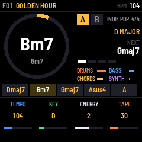
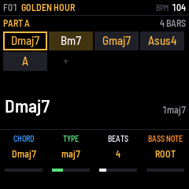
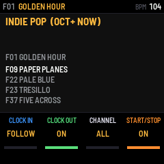
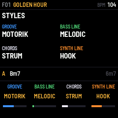
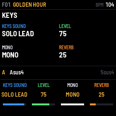
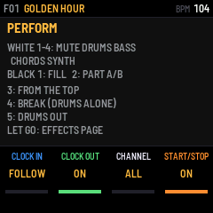
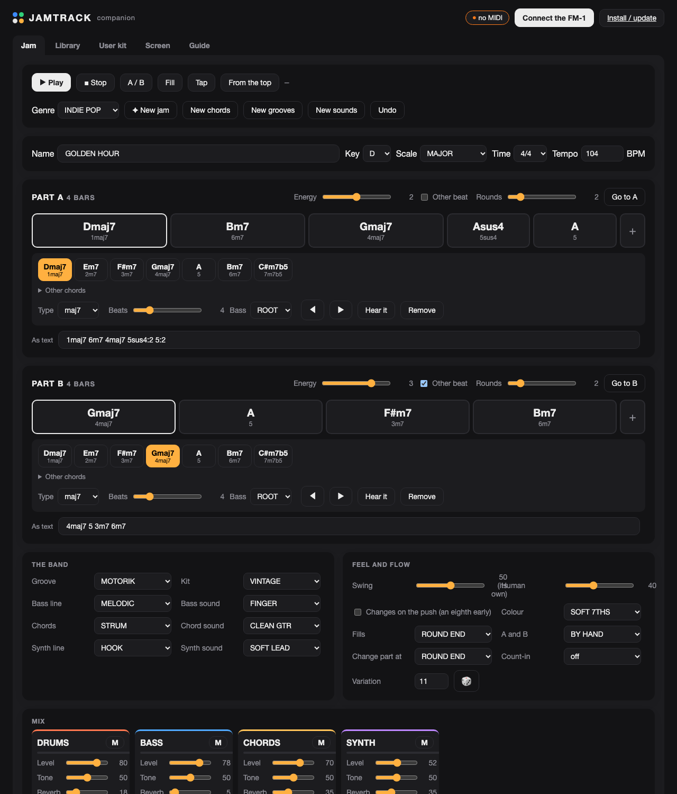
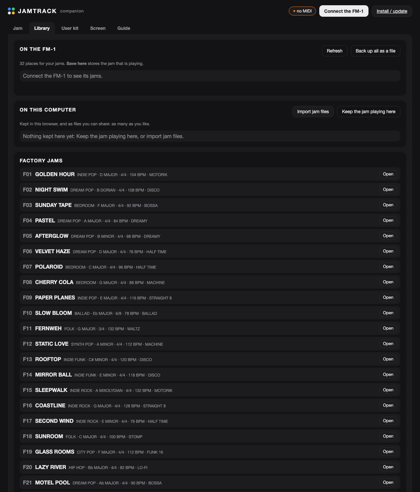
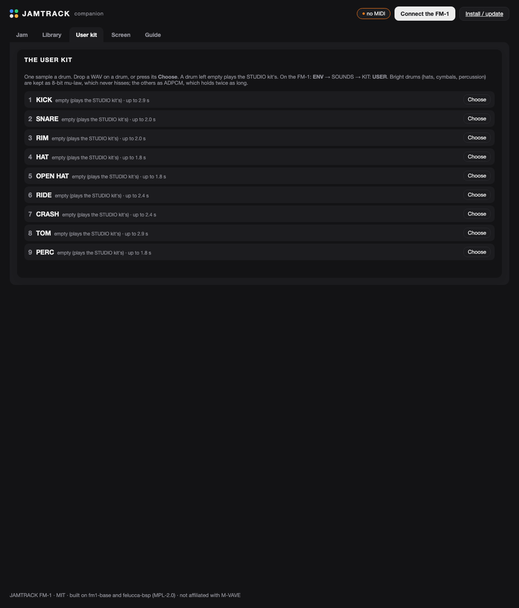
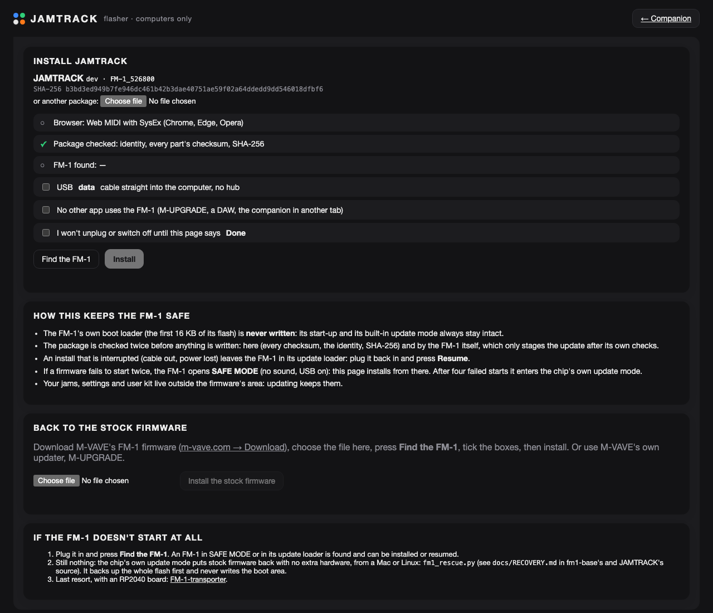

<p align="center"></p>

<p align="center">
  <b>A free, open-source backing band for the M-VAVE FM-1</b><br>
  Drums, bass, chords and a synth line that follow a chord progression in any key and time signature, in time with
  your loop pedal. Play over it: solos, vocals, a one-person band.
</p>

<p align="center">
  <a href="https://philip-bos.github.io/jamtrack-fm1/flasher/"><b>Install it</b></a> ·
  <a href="https://philip-bos.github.io/jamtrack-fm1/"><b>Companion app</b></a> ·
  <a href="https://philip-bos.github.io/jamtrack-fm1/#guide">Guide</a> ·
  <a href="https://github.com/Philip-Bos/jamtrack-fm1/releases">Releases</a>
</p>

<p align="center">
  
  
  
</p>

---

## What it is

JAMTRACK turns the FM-1 into a band you can jam with. Write a progression as numbers (`1maj7 6m7 4maj7 5sus4`), pick
a key and a groove, press PLAY. Change the key and the song moves with it. Switch between a verse (part A) and a
chorus (part B) with a fill, end on a last hit, start and stop from a loop pedal.

- **Indie first.** Dreamy half-time, disco four-on-the-floor, bossa bedroom pop, motorik, jangly strums, octave bass,
  Rhodes and Wurli, clean chorused guitars, Juno-style pads. Then rock, folk, soul, city pop, blues, hip hop, reggae,
  jazz, country, synth pop and ballads.
- **Four players.** 20 grooves, 16 bass lines (with approach notes into the next chord), 16 comping styles (strums,
  fingerpicking, stabs, arpeggios) and 9 synth lines (hooks, counter-melodies, arps, bells), each its own choice.
- **26 sounds and 10 kits**, all made from scratch: acoustic kits (VINTAGE, STUDIO, ROOM, BRUSHES, LO-FI, ROCK,
  CAJON), drum machines (LM-80, RHYTHM BOX, 808), and a **USER kit** from your own samples.
- **Every time signature it needs:** 4/4, 3/4, 6/8, 12/8, 2/4, 5/4, 7/8. Every groove plays in all of them.
- **38 factory jams** browsed by genre, and **GENERATE**: a new jam in the genre at a press, or only new chords,
  grooves or sounds.
- **A ring around the chord playing** fills as it plays, so you always know when the change comes; the keys light
  up the chord's notes and the scale, a map to solo over.
- **Solo on the FM-1's keys** with three leads made for it (or any other sound), mono with glide, on their own level.
- **Loop pedals:** MIDI clock in (START begins on the clock's first tick), STOP, CONTINUE, tap tempo, footswitch CCs.
- **32 places** on the FM-1 for your jams, and as many as you like in the companion (and as files).
- **The companion app** (Chrome or Edge): the jam editor, the library, the user kit, the FM-1's screen, the guide,
  and the installer.

<p align="center">
  
  
  
</p>

## Playing it

| | |
| --- | --- |
| **PLAY** | start / stop (STOP MODE: at once, or at the bar's end with a last hit) |
| **SEQ** | part A / B, at the end of the round with a fill (held: a fill now) |
| **REC** | tap tempo (held: from the top of the part) |
| **ALGORITHM** | the genre: its first jam starts 2 s after you stop turning (OCT+: now, OCT-: never mind) |
| **PRESETS** | browse the genre's jams the same way; the last one, **+ NEW**, generates one |
| **ARP** | GENERATE in the genre; on EDIT the chords, on LFO the grooves, on ENV the sounds (held: a whole new jam). **OCT- + OCT+**: undo |
| **SEL** | which part EDIT works on; **held + a key**: the jam's key |
| **SAVE** | SAVE again to keep the jam (SELECT picks the place) |
| **HOME · EDIT · ENV · LFO · FX · GLO** | pages; again for the group's next page; hold HOME: what the page does |
| **K1–K4** | the page's four settings. SELECT: the tempo (on EDIT: the chord; SEL held: the keys' sound) |
| **keys** | play along on their own sound (SOLO LEAD by default; GLO → KEYS); their lights show the chord and the scale |
| **FX held + keys** | white 1–4 mute drums / bass / chords / synth; black: fill, part, from the top, break, drums out |

The companion's **[Guide](https://philip-bos.github.io/jamtrack-fm1/#guide)** has the chords, the MIDI CC map and the
loop-pedal setup.

## The companion app

Open **[the companion](https://philip-bos.github.io/jamtrack-fm1/)** in Chrome, Edge or Opera on a computer and press
**Connect the FM-1** (it talks to it over USB-MIDI; nothing to install).

<p align="center"></p>

| | |
| --- | --- |
| **Jam** | everything about the jam, live on the FM-1 as you change it: the progressions as chords of the key (or typed as numbers: `1maj7 6m7 4maj7 5sus4:2 5:2`), the band, the feel, the mix, the effects, the keys' sound, GENERATE by genre, the transport, the chord playing lit as it plays |
| **Library** | the FM-1's 32 places (load, save, rename, delete), as many jams as you like in the browser and as files to share, a backup of them all, the factory's |
| **User kit** | a sample for each drum: drop in any audio file, hear it as the FM-1 will play it, send it |
| **Screen** | the FM-1's screen live, its panel playable from the computer, PNG screenshots |
| **Guide** | a quick start, the chords, the loop pedal, the MIDI map, the panel |

<p align="center">
  
  
</p>

## Install

Open **[the flasher](https://philip-bos.github.io/jamtrack-fm1/flasher/)** on a computer (Chrome, Edge or Opera), plug
the FM-1 in with a USB data cable, press **Find the FM-1**, tick the boxes and press **Install**. It takes about a
minute. Offline, the same pages run from the source: `python3 companion/serve.py` (http://localhost:8747).

<p align="center"></p>

It installs through fm1-base and felucca-bsp's update path, the same as ECHOFIELD:
- **The boot area is never written**, so the FM-1's start-up and its built-in update mode always survive.
- **The package is checked twice**, by the flasher (identity, every part's checksum, SHA-256) and by the FM-1 itself.
- **An interrupted install resumes**, and failed starts open SAFE MODE with USB working.
- **Going back is one page away:** the stock firmware installs from the same page, or with M-VAVE's M-UPGRADE.

If anything goes wrong, see [docs/RECOVERY.md](docs/RECOVERY.md).

## How it works

The engine ([`app/dsp/`](app/dsp)) runs in the audio interrupt, in chunks of up to 32 samples cut wherever a clock
tick or a note falls:
- **The sequencer** counts MIDI clock ticks (24 a quarter note). On its own time it runs at the tempo. Following a
  clock, it runs at the clock's measured pace but never past a tick that has not come in, so every step lands on its
  tick and a clock that slows, speeds up or stops is followed at once.
- **The players** read step patterns written for three bar shapes (4/4, 3/4 and 6/8) and stitched together for the
  others. They take the chord under each step: Nashville numbers resolved in the key and scale, voiced to move as
  little as possible from the last chord.
- **The voices:** subtractive (two oscillators, a resonant filter), FM (electric pianos, bells), Karplus-Strong
  strings (guitars, upright and muted basses) and a drawbar organ. Ten drum voices play samples: ADPCM for the drums,
  8-bit mu-law for the bright ones.
- **The effects:** chorus, tremolo, a four-line reverb, TAPE (wow, flutter, warmth on the lows), drum-bus glue, a
  limiter, and ECHOFIELD's side limiter for the FM-1's headphone amplifier. The voices, drums and mix run from RAM.

Measured on an FM-1: the render takes 40–60 % of its time on average and peaks near 70 %, with no dropouts.

## Building from source

What you need: the JieLi toolchain and AC79 SDK (`base/tools/get_toolchain.sh`, see
[fm1-base](https://github.com/charlesvestal/fm1-base)), Docker on macOS, Python 3 and Node.js.

```bash
git clone --recursive https://github.com/Philip-Bos/jamtrack-fm1
cd jamtrack-fm1
python3 -m venv .venv && .venv/bin/pip install numpy Pillow fonttools mido python-rtmidi
tools/run_tests.sh                          # every test; no FM-1 needed
python3 base/tools/build.py app             # the firmware: app/build/jamtrack.fwsc
tools/release.sh 0.1                        # tests, a release build, the companion's package, dist/
```

The drum samples are made, not recorded: `tools/make_kits.py` synthesizes them and `tools/encode_kits.mjs` writes
`app/dsp/kits_data.h`.

The tests cover:
- **The engine, under AddressSanitizer and UBSan:** every genre, groove, style and sound, every time signature,
  extremes, MIDI clock in and out, A/B, count-in and the ending.
- **The app in fm1-base's FM-1 simulator:** the panel, the editor, saving across reboots, the user kit, footswitch
  MIDI and clock.
- **The companion's theory against the firmware's:** 26,460 chords, every factory jam.
- **With an FM-1 plugged in**, `node app/tests/device_test.mjs` drives the companion's protocol client against the real
  thing.

| | |
| --- | --- |
| [`app/dsp/`](app/dsp) | the engine: theory, styles, sounds, voices, drums, effects, sequencer, generator |
| [`app/`](app) | the panel and screens, the jams, the user kit, the USB protocol, the factory jams |
| [`companion/`](companion) | the web app and `flasher/` |
| [`tools/`](tools) | tests, release, the drum sample generator, a command-line remote (`jtctl.py`) |
| `base/` | [fm1-base](https://github.com/charlesvestal/fm1-base), pinned (with felucca-bsp in `base/bsp`) |

## Credits

- **[fm1-base](https://github.com/charlesvestal/fm1-base)** by **Charles Vestal**: the FM-1 platform, simulator, build and
  installer. MPL-2.0.
- **[felucca-bsp](https://github.com/hugelton/felucca-bsp)** by **Leo Kuroshita** (Hügelton Instruments): the chip and board
  support, the update loader, the rescue tools. MPL-2.0.
- **ECHOFIELD** (the same author): the sample codec, the flasher, the screen mirror page and the lessons learned on
  the FM-1's hardware.

JAMTRACK is by **Philip Bos**. MIT; the drum samples are CC0. See [LICENSING.md](LICENSING.md).

*M-VAVE and FM-1 are trademarks of their owners. JAMTRACK is an independent project, not affiliated with or endorsed by
M-VAVE. Custom firmware is installed at your own risk.*
